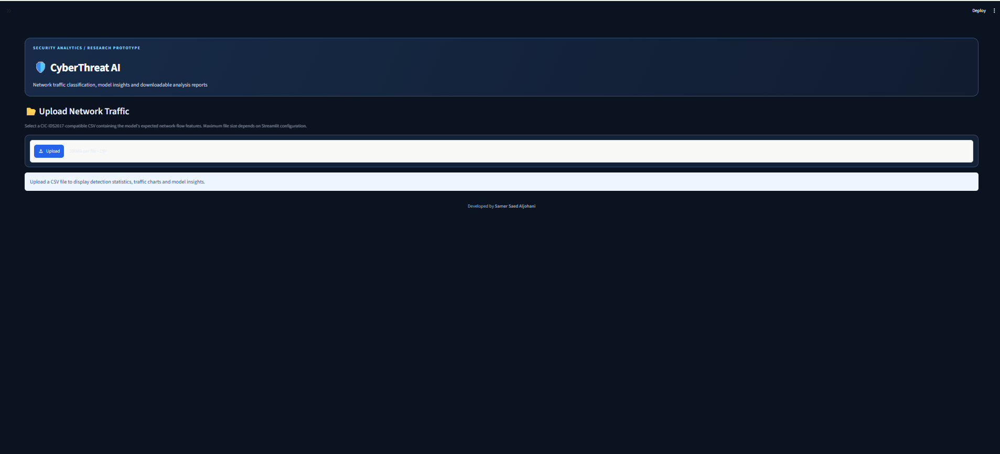
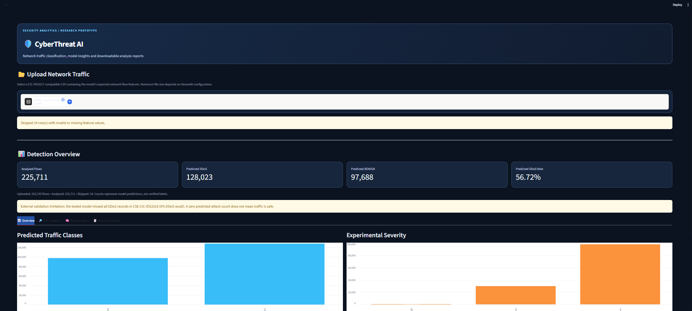
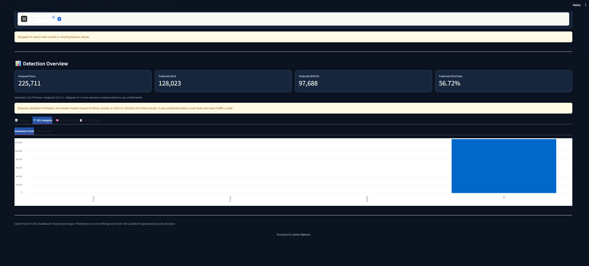
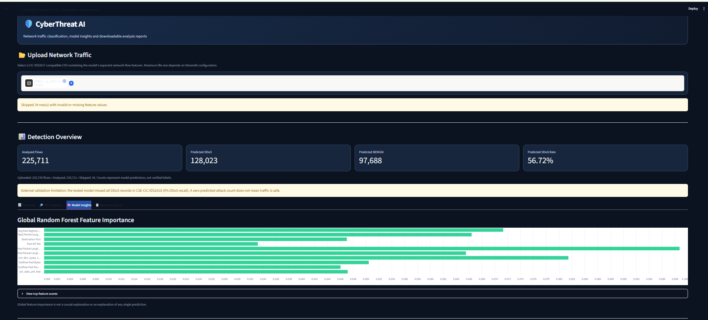
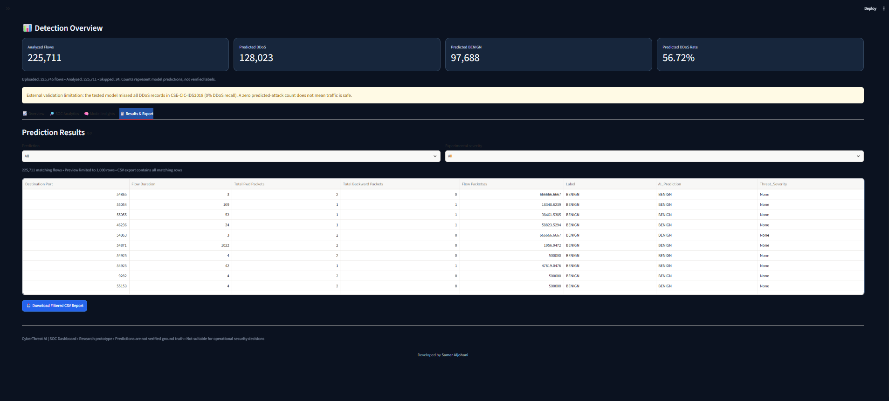

# CyberThreat AI

Machine Learning-Based Network Threat Detection and Analysis Dashboard

## Overview

CyberThreat AI is a research prototype for analyzing network flow records and classifying traffic as BENIGN or DDoS using machine learning.

The project combines a Random Forest classifier, a Streamlit dashboard, CSV analysis, and evaluation reports.

**Status:** Research prototype. Not suitable for production security monitoring.

## Technology Stack

- Python
- Scikit-learn
- Pandas and NumPy
- Streamlit
- Joblib
- Matplotlib

## Datasets

- CIC-IDS2017: Model training and internal evaluation
- CSE-CIC-IDS2018: External generalization evaluation

## Model

Algorithm: Random Forest

Original model:
- 78 features
- 100 estimators
- Maximum depth: 15

Experimental model:
- 64 features
- 150 estimators
- Maximum depth: 12
- Minimum samples per leaf: 5

## Evaluation Results

| Metric | Original Model | Experimental Model |
|---|---:|---:|
| Internal Accuracy (2017) | 99.9910% | 99.9574% |
| Internal F1-score (2017) | 99.9922% | 99.9629% |
| External Accuracy (2018) | 34.41% | 34.41% |
| External DDoS Recall (2018) | 0% | 0% |

The external evaluation included 1,048,575 records:
- 360,833 BENIGN
- 687,742 DDoS

Both models classified all external records as BENIGN.

## Research Findings

The models performed very well on a random internal split from CIC-IDS2017 but failed to generalize to the evaluated CSE-CIC-IDS2018 dataset.

Significant differences were observed in flow duration, packet lengths, TCP window sizes, and packet rates.

Feature-name alignment does not guarantee equivalent feature extraction across datasets.

The external dataset was also used for diagnostic analysis, so subsequent model comparisons against it are developmental rather than independent final evaluations.

## Installation

Create a virtual environment:

```powershell
python -m venv .venv
```

Install dependencies:

```powershell
.\.venv\Scripts\python.exe -m pip install -r requirements.txt
```

Run the dashboard:

```powershell
.\.venv\Scripts\python.exe -m streamlit run app.py
```

## Limitations

- Binary BENIGN/DDoS classification only
- Limited diversity of training scenarios
- Poor external generalization
- Possible feature-extraction differences between datasets
- No real-time network monitoring
- Not validated for production use

## Future Work

- Train on multiple attack scenarios and capture sessions
- Validate feature-extraction consistency
- Use session-based and time-based evaluation splits
- Evaluate on untouched external datasets
- Improve model calibration and robustness

## References

- CIC-IDS2017:
  https://www.unb.ca/cic/datasets/ids-2017.html
- CSE-CIC-IDS2018:
  https://www.unb.ca/cic/datasets/ids-2018.html
- Scikit-learn:
  https://scikit-learn.org/stable/

## Disclaimer

CyberThreat AI is an educational and research project. Its predictions should not be used as the sole basis for security decisions.

---

## Dashboard Screenshots

### 1. Main Dashboard


### 2. Detection Overview


### 3. SOC Analytics


### 4. Model Insights


### 5. Results & Export


---
**Developed by Samer Saed Aljohani**

